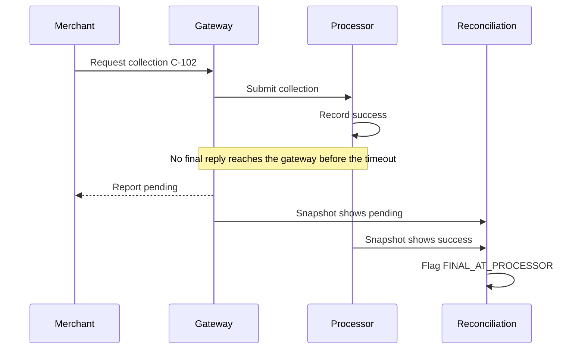

# Investigating a payment timeout

## Business requirement

A payment operations analyst needs to identify collections and payouts where the gateway and processor disagree. A merchant may see a timeout after the processor has already completed a transaction. The review queue must keep that case distinct from an explicit decline.

**Acceptance goal.** Each distinct merchant and transaction reference produces one finding. The report must preserve enough evidence to investigate the finding, even when one extract contains duplicate rows.

## Example sequence

**Design decision.** A timeout establishes that the gateway lacks a timely response. It leaves the transaction outcome unknown. The analyst should verify the original reference with the processor before correcting a ledger or permitting another collection. This implementation ends at the review queue.

## Input contract

Each CSV has the same six columns. Both extracts must cover the same reporting cutoff, merchant population and currency conventions. One row represents a transaction's latest status at that cutoff. An event stream would first need to be reduced to a snapshot.

| Field | Contract |
| --- | --- |
| `merchant`, `reference` | Nonblank, case-sensitive strings. Their pair identifies one transaction across both systems. A reference may recur at another merchant. |
| `direction` | `COLLECTION` or `PAYOUT`. Direction is compared after matching on the key so a misclassified payout is visible. |
| `currency` | Three uppercase letters. Upstream systems supply the agreed currency code. |
| `amount_minor` | Positive integer in the currency's minor unit, within SQLite's signed 64-bit range. Direction is a separate field. |
| `status` | `PENDING`, `SUCCEEDED` or `FAILED`. Map provider-specific statuses before ingestion. |

## Decision table and acceptance coverage

Apply the first matching row. In a row with several mismatches, the JSON retains the fields from both unique records so an analyst can inspect the remaining differences. Duplicate rows block a comparison of individual values on that side.

| Priority | Condition | Finding | QA test in test_reconcile.py |
| --- | --- | --- | --- |
| 1 | More than one row on either side | DUPLICATE | test_duplicates_are_not_collapsed_or_summed |
| 2 | Only one side has a record | GATEWAY_ONLY or PROCESSOR_ONLY | test_one_sided_and_empty |
| 3 | Directions differ | DIRECTION_MISMATCH | test_material_differences_and_precedence |
| 4 | Currencies differ | CURRENCY_MISMATCH | test_material_differences_and_precedence |
| 5 | Amounts differ | AMOUNT_MISMATCH | test_material_differences_and_precedence |
| 6 | Gateway pending and processor final | FINAL_AT_PROCESSOR | test_uncertain_or_conflicting_outcomes |
| 7 | Other status disagreement | STATUS_MISMATCH | test_uncertain_or_conflicting_outcomes |
| 8 | Both sides pending | BOTH_PENDING | test_uncertain_or_conflicting_outcomes |
| 9 | Both sides agree on a final state | MATCHED | test_final_agreement |

## Delivery notes

- **Implementation task.** Validate both CSVs, compare the union of their keys and emit stable results ordered by merchant and reference. Row counts on each side must survive the comparison.
- **QA task.** Run the eight-reference fixture, then replay it. Both runs must return identical evidence. Change only the merchant ID and verify the records become two one-sided findings. Tests also exercise malformed inputs and conflicting final states.
- **Operational dependency.** If the two snapshots have different cutoffs, a one-sided finding may only indicate a late extract. Verify report completeness before contacting a merchant or correcting records.
- **Scope.** Amounts are gross transaction amounts. Fees, exchange rates, split captures, refunds and multi-leg settlement need additional identifiers and rules. This review compares transaction states and amounts. It cannot establish bank settlement finality.
